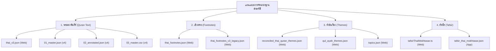

# แผนแม่บทการจัดมาตรฐานอักขรวิธีและคำทับศัพท์อัลกุรอาน
## (Master Spelling & Transliteration Standardization Plan)
**ครอบคลุม 4 เสาหลัก: คำแปลพระมหาคัมภีร์ (Quran Texts) • เชิงอรรถ (Footnotes) • หัวข้อเรื่อง (Themes) • คำอธิบายตัฟซีร (Tafsir)**

---

## 1. บทนำและวัตถุประสงค์ (Executive Summary)

ในการพัฒนาและสังเคราะห์ฐานข้อมูลอัลกุรอานภาษาไทย (`thai-quran-web`, `thai_quran_translation_v4`, และ `thai-quran-app`) ที่ผ่านมา ข้อมูลถูกรวบรวมมาจากหลายแหล่งข้อมูลในอดีต (เช่น ฉบับพิมพ์พระราชทานปี 1990, ระบบ OCR ดิจิทัล, ฐานข้อมูลตัฟซีรมุคตะศ็อร และคลังหัวข้อธีม Qul) 

จากการตรวจวิเคราะห์ข้อมูลเชิงลึก (Deep Corpus Audit) พบว่ายังมี **ความไม่สม่ำเสมอของคำทับศัพท์และอักขรวิธี (Spelling Inconsistencies)** กระจัดกระจายอยู่กว่า 500+ จุด ทั้งในด้านการใช้เครื่องหมายพินทุ (ฺ U+0E3A), การใช้ไม้ทัณฑฆาต/การันต์ (์ U+0E4C), สระยาว-สั้น, และตัวสะกดอักษรภาษาอาหรับ

แผนแม่บทฉบับนี้กำหนด **"ตารางอักขรวิธีมาตรฐานสากล (Canonical Orthography Matrix)"** เพื่อปรับปรุงฐานข้อมูลทั้งหมดให้เป็นเอกภาพ 100% สละสลวย ถูกต้องตามหลักภาษาศาสตร์ และคงความศักดิ์สิทธิ์ตามจารีตอิสลาม

---

## 2. ตารางเทียบมาตรฐานอักขรวิธี (Canonical Orthography Matrix)

### หมวดที่ 1: พระนามอัลลอฮฺ พระวจนะ และคำสรรเสริญ (Divine Names & Sanctified Formulae)

| คำมาตรฐาน | คำเดิมที่พบความไม่สม่ำเสมอ | แหล่งที่พบ | กฎเกณฑ์ทางภาษา |
| :--- | :--- | :--- | :--- |
| **อัลลอฮฺ** | อัลลอฮ์, อัลลออฮ์, อัลลออ์, อัลลอฮ | Tafsir, Footnotes | ใช้พินทุใต้ ฮ เพื่อแทนเสียงเสียดแทรกท้ายเสียง (Hā' Sakinah) ตามมาตรฐานอัลกุรอาน |
| **ศ็อลลัลลอฮุอะลัยฮิวะซัลลัม** | ศ็อลลัลลอฮ์, ศ็ลลัลลอฮุ | Tafsir | ข้อความสรรเสริญเต็มรูปที่ถูกต้องตามไวยากรณ์ |
| **บิสมิลลาฮฺ** | บิสมิลลาฮ์ | Tafsir, Footnotes | มาตรฐานพินทุใต้ ฮ |
| **อัลฮัมดุลิลลาฮฺ** | อัลฮัมดุลิลลาฮ์, อัลฮัมดุลิลลอฮ์ | Tafsir, Footnotes | มาตรฐานพินทุใต้ ฮ |
| **ซุบฮานัลลอฮฺ** | ซุบฮานัลลอฮ์, ซุบฮ์านัลลอฮ์ | Tafsir, Footnotes | มาตรฐานพินทุใต้ ฮ |
| **รอซูลุลลอฮฺ** | ร่อซูลุลอฮ์, รอซูลุลอฮ์, ร่อซูลุลลอฮฺ | Themes, Footnotes | สระ "รอ" และ ลามคู่ พร้อมพินทุใต้ ฮ |
| **เราะฮฺมาน / อัรเราะฮฺมาน** | เราะห์มาน, รอห์มาน | Footnotes | ใช้ ฮ พินทุ แทนการใช้ ห หีบ |
| **เราะฮฺมัต** | เราะห์มัต, เราะห์มัด | Footnotes | ใช้ ฮ พินทุ |

---

### หมวดที่ 2: บรรดานบี มลาอิกะฮฺ และบุคคลในประวัติศาสตร์ (Prophets, Angels & Personalities)

| คำมาตรฐาน | คำเดิมที่พบความไม่สม่ำเสมอ | แหล่งที่พบ | สถิติที่พบ | กฎเกณฑ์ทางภาษา |
| :--- | :--- | :--- | :---: | :--- |
| **รอซูล** | ร่อซูล, ร่อซู้ล | Themes (Qul & Reconciled) | 29 แห่ง | บังคับใช้รูป "รอซูล" ไร้วรรณยุกต์ |
| **มลาอิกะฮฺ** | มะลาอิกะฮฺ, มลาอิกะฮ์, มะลาอิกะห์ | Footnotes, Themes | - | บังคับใช้ "มลาอิกะฮฺ" (ม ล ควบกล้ำ + ฮฺ พินทุ) |
| **บะนีอิสรออีล** | บนีอิสรออีล, ยะบีอิสรออีล | Footnotes, Tafsir, Themes | 48 แห่ง | เติมสระอะ "บะนี" และสระออ "อิสรออีล" |
| **อิสรออีล** | อิสราอีล | Tafsir, Footnotes | 7 แห่ง | ใช้สระออ (รอ ร เรือ) ตามสำเนียงกุรอานีย์ |
| **อิบรอฮีม** | อิบราฮิม, อิบรอฮิม | Tafsir, Footnotes | 3 แห่ง | ใช้สระยาว "ฮีม" |
| **อิสมาอีล** | อิสมาอิล | Footnotes | - | ใช้สระยาว "อีล" |
| **มุฮัมมัด** | มูฮัมมัด, มูฮัมหมัด | Footnotes | - | ใช้สระอุ "มุ" และ ด เด็กสะกด |
| **ยะฮฺยา** | ยะห์ยา, ยะฮห์ยา | Footnotes | - | ใช้ ฮ พินทุ (ยะฮฺ) |
| **นูฮฺ** | นูห์, นูฮ์, นูหฺ | Footnotes | - | ใช้ ฮ พินทุ |
| **ลูฏ** | ลู๊ฏ, ลูต | Translation | 1 แห่ง | ใช้ ฏ ปฏัก ไร้วรรณยุกต์ตรี |
| **ฟิรเอานฺ** | ฟิรเอาน์, ฟิรอาวน์ | Footnotes | - | บังคับใช้พินทุใต้ น (ฟิรเอานฺ) |

---

### หมวดที่ 3: คัมภีร์และบทบัญญัติแห่งฟากฟ้า (Heavenly Scriptures & Revelations)

| คำมาตรฐาน | คำเดิมที่พบความไม่สม่ำเสมอ | แหล่งที่พบ | สถิติที่พบ | กฎเกณฑ์ทางภาษา |
| :--- | :--- | :--- | :---: | :--- |
| **อัต-เตารอต** | อัตเตารอต, เตารอฮ์ | Translation, Footnotes, Tafsir, Themes | **104 แห่ง** | เติมยัติภังค์คั่นหน้าระหว่างคำนำหน้านามชี้เฉพาะ "อัต-" และ "เตารอต" |
| **อัล-อินญีล** | อัลอินญีล | Translation, Footnotes, Tafsir | **52 แห่ง** | เติมยัติภังค์คั่น "อัล-" และ "อินญีล" ให้สอดคล้องกับ อัต-เตารอต |
| **ซะบูรฺ** | ซะบูร, ซะบูร์ | Translation, Footnotes | 8 แห่ง | ใช้พินทุใต้ ร (ซะบูรฺ) แทน ร การันต์ หรือ ร โดด |
| **อัลกุรอาน** | อัล-กุรอาน | Footnotes, Tafsir | 3 แห่ง | เขียนติดกันเป็นคำสมาสชี้เฉพาะ "อัลกุรอาน" |

---

### หมวดที่ 4: ศัพท์ศาสนบัญญัติและภพหน้า (Theological, Jurisprudential & Eschatological Terms)

| คำมาตรฐาน | คำเดิมที่พบความไม่สม่ำเสมอ | แหล่งที่พบ | สถิติที่พบ | กฎเกณฑ์ทางภาษา |
| :--- | :--- | :--- | :---: | :--- |
| **มุอฺมิน** | มุอ์มิน | Footnotes, Tafsir, Translation | **253 แห่ง** | ใช้พินทุใต้ อ (มุอฺมิน) แทน อ การันต์ ตามเกณฑ์ฮัมซะฮฺกุรอานีย์ |
| **วะฮียฺ** | วะฮีย์, วะฮีห์ | Footnotes, Tafsir, Themes | **66 แห่ง** | ใช้พินทุใต้ ย (วะฮียฺ) ตามมาตรฐานสากล |
| **หิกมะฮฺ** | ฮิกมะฮฺ, ฮิกมะฮ์ | Footnotes, Translation, Tafsir | 41 แห่ง | ใช้ ห หีบ (หิกมะฮฺ) สอดคล้องกับตัวบท حِكْمَة |
| **ชิรกฺ** | ชิริก, ชิรฺก์ | Footnotes, Themes, Translation | 46 แห่ง | ใช้พินทุใต้ ก (ชิรกฺ) ตัดสระแทรกที่ไม่ตรงตัวบท |
| **ฮะดีษ** | หะดีษ, ฮะดีส, หะดีส | Footnotes | 21 แห่ง | ใช้ ฮ นกฮูก และ ษ ฤๅษี ตามมาตรฐานสากล |
| **ชัยฏอน** | ชัยตอน, ชัยฎอน | Tafsir, Themes | 18 แห่ง | ใช้ ฏ ปฏัก ตามตัวบท شَيْطَان |
| **ซุนนะฮฺ** | สุนนะฮฺ, สุนนะห์ | Tafsir | 10 แห่ง | ใช้ ซ โซ่ ตามตัวบท سُنَّة |
| **ญะฮันนัม** | ยะฮันนัม | - | - | ใช้ ญ หญิง ตามตัวบท جَهَنَّم |
| **กะอฺบะฮฺ** | กะอ์บะฮ์, กะอ์บะฮฺ | Footnotes | - | ใช้พินทุใต้ อ และ ฮ |
| **กิยามะฮฺ** | กิยามะฮ์, กิยามะห์ | Footnotes | - | ใช้ ะฮฺ พินทุ |
| **อาคิเราะฮฺ** | อาคิเราะฮ์, อาคิเราะห์ | Footnotes | - | ใช้ ะฮฺ พินทุ |
| **อิบาดะฮฺ** | อิบาดะฮ์, อิบาดะห์ | Footnotes | - | ใช้ ะฮฺ พินทุ |

---

## 3. ขอบเขตไฟล์เป้าหมาย (Scope of Impacted Datasets)

---

## 4. ขั้นตอนการปฏิบัติการ 4 เฟส (4-Phase Execution Roadmap)

### เฟสที่ 1: การเตรียมเครื่องมือและการสำรองข้อมูล (Safety & Tooling)
1. ทำการสร้างสำเนา Snapshot สำรองไฟล์เป้าหมายทั้งหมดก่อนเริ่มแก้ไข
2. พัฒนาสคริปต์ตรวจสอบแบบอัตโนมัติ `scripts/run_spelling_standardization.py` ที่มีระบบ Dry-run และ Diff Report ชัดเจน

### เฟสที่ 2: ดำเนินการปรับปรุงตามลำดับความสำคัญ (Batch Execution)
* **Batch A (Themes & Topics):** ดำเนินการ `reconciled_thai_quran_themes.json`, `qul_ayah_themes.json`, `topics.json` (เน้น `ร่อซูล` -> `รอซูล`, `ชิริก` -> `ชิรกฺ`, `บนีอิสรออีล` -> `บะนีอิสรออีล`)
* **Batch B (Tafsir):** ดำเนินการ `tafsirThaiMokhtasar.ts` และ `tafsir_thai_mokhtasar.json` (เน้น `อัตเตารอต` -> `อัต-เตารอต`, `อัลอินญีล` -> `อัล-อินญีล`, `ชัยตอน` -> `ชัยฏอน`)
* **Batch C (Footnotes):** ดำเนินการ `thai_footnotes.json` (เน้น `มุอ์มิน` -> `มุอฺมิน` 250 จุด, `วะฮีย์` -> `วะฮียฺ` 53 จุด, `ชิริก` -> `ชิรกฺ` 34 จุด)
* **Batch D (Quran Translations):** ดำเนินการ `thai_v3.json` และชุดข้อมูล v4 (เน้น `อัตเตารอต` -> `อัต-เตารอต` 16 จุด, `อัลอินญีล` -> `อัล-อินญีล` 11 จุด, `ซะบูร` -> `ซะบูรฺ` 3 จุด)

### เฟสที่ 3: การตรวจสอบความสมบูรณ์และทดสอบระบบ (Verification & Quality Gates)
1. รัน TypeScript Compiler (`npx tsc --noEmit`) บน `thai-quran-web`
2. ตรวจสอบความถูกต้องของ JSON syntax ทั้งหมด
3. รัน Regression Scan ตรวจสอบว่าไม่มีคำศัพท์ที่ผิดเพี้ยนหลุดรอด

### เฟสที่ 4: การจัดเก็บบันทึกความโปร่งใสและส่งขึ้นระบบ (Documentation & Deploy)
1. อัปเดตบันทึกการเปลี่ยนแปลงลงใน Errata & Transparency Log
2. Commit & Push ขึ้น GitHub ทั้ง 2 Repos พร้อมแท็ก `[deploy]` เพื่อเผยแพร่ใช้งานจริง
