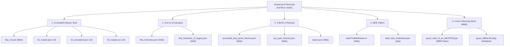

# แผนแม่บทการจัดมาตรฐานอักขรวิธีและคำทับศัพท์อัลกุรอาน
## (Master Spelling & Transliteration Standardization Plan)
**ครอบคลุม 5 เสาหลัก: คำแปลพระมหาคัมภีร์ (Quran Texts) • เชิงอรรถ (Footnotes) • หัวข้อเรื่อง (Themes) • คำอธิบายตัฟซีร (Tafsir) • คำแปลคำต่อคำ (Word-by-Word WBW)**

---

## 1. บทนำและวัตถุประสงค์ (Executive Summary)

ในการพัฒนาและสังเคราะห์ฐานข้อมูลอัลกุรอานภาษาไทยครบวงจร (`thai-quran-web`, `thai_quran_translation_v4`, `thai-quran-app`, และ `wbw-translation-en-th`) 

จากการตรวจวิเคราะห์ข้อมูลเชิงลึก (Corpus Deep Audit) ล่าสุด พบความไม่สม่ำเสมอของคำทับศัพท์และอักขรวิธี (Spelling Inconsistencies) กระจัดกระจายอยู่กว่า **800+ จุด** ในทุกมิติ ทั้งพระนามนบี, นามของกลุ่มชน/ประชาชาติโบราณ, คัมภีร์ศักดิ์สิทธิ์, ศัพท์ศาสนบัญญัติ, และคำแปลคำต่อคำ (WBW)

แผนแม่บทฉบับนี้กำหนด **"ตารางอักขรวิธีมาตรฐานสากล (Canonical Orthography Matrix)"** ครบทั้ง 5 เสาหลัก เพื่อปรับปรุงฐานข้อมูลทั้งหมดให้เป็นเอกภาพ 100% สละสลวย ถูกต้องตามหลักภาษาศาสตร์ และคงความศักดิ์สิทธิ์ตามจารีตอิสลาม

---

## 2. พระนามของบรรดานบีทั้ง 25 ท่าน (The 25 Quranic Prophets)

จากการสแกนพบความไม่สม่ำเสมอในพระนามนบีหลายท่าน (เช่น `ลูต` แทน `ลูฏ`, `ดาวู๊ด` แทน `ดาวูด`, `นูหฺ` แทน `นูฮฺ`, `ซอและฮฺ` แทน `ศอและฮฺ/ศอลิหฺ`, `ชุไอบ์` แทน `ชุอัยบฺ`) แผนแม่บทจึงกำหนดมาตรฐานดังนี้:

| ลำดับ | ภาษาอาหรับ | พระนามมาตรฐาน | รูปเดิมที่พบความคลาดเคลื่อน | สถิติที่พบในระบบ | กฎเกณฑ์ทางภาษา |
| :---: | :--- | :--- | :--- | :---: | :--- |
| 1 | **آدَم** | **อาดัม** | อาดัมฯ | - | ใช้สระอา ด เด็ก ม ม้า |
| 2 | **إِدْرِيس** | **อิดรีส** | อิดรีซ | - | ส เสือ แทนตัว س |
| 3 | **نُوح** | **นูฮฺ** | นูหฺ, นูห์, นูฮ์, นุห์, นุฮฺ | **62 แห่ง** | ใช้ **`ฮฺ` (ฮ นกฮูก พินทุ)** ตามมาตรฐานเสียงท้าย Waqf (แก้ใน Tafsir 56 แห่ง และ WBW 33 แห่ง) |
| 4 | **هُود** | **ฮูด** | ฮู๊ด | 1 แห่ง | ตัดวรรณยุกต์ตรีออก |
| 5 | **صَالِح** | **ศอลิหฺ** *(หรือ ศอและฮฺ)* | **ซอและฮฺ**, ซอลิห์, ศอลิห์ | **27 แห่ง** | บังคับใช้ **`ศ` (ศ ศาลา)** แทน ซ โซ่ ทั้งหมด 100% (แก้ `ซอและฮฺ` ในตัวบท 4 แห่ง, เชิงอรรถ 18 แห่ง) |
| 6 | **إِبْرَاهِيم** | **อิบรอฮีม** | อิบราฮิม, อิบรอฮิม | 3 แห่ง | ใช้สระยาว "ฮีม" |
| 7 | **لُوط** | **ลูฏ** | **ลูต**, ลู๊ฏ | **20 แห่ง** | บังคับใช้ **`ฏ` (ฏ ปฏัก)** แทน ต เต่า และตัดวรรณยุกต์ตรี (แก้ในตัวบท 7 แห่ง, WBW 5 แห่ง) |
| 8 | **إِسْمَاعِيل** | **อิสมาอีล** | อิสมาอิล | - | ใช้สระยาว "อีล" |
| 9 | **إِسْحَاق** | **อิสฮาก** | **อิสหาก** | 12 แห่ง | ใช้ **`อิสฮาก`** (อักษร ح ฮาอ์เล็ก) ห้ามสะกดตกหล่นเป็น อิสหาก |
| 10 | **يَعْقُوب** | **ยะอฺกูบ** | ยะอ์กูบ, ยะอฺกู๊บ | 3 แห่ง | ใช้พินทุใต้ อ (ยะอฺ) และตัดวรรณยุกต์ตรี |
| 11 | **يُوسُف** | **ยูซุฟ** | ยูสุฟ | - | ใช้ ซ โซ่ และ ฟ ฟัน |
| 12 | **أَيُّوب** | **อัยยูบ** | อัยยู๊บ, อัยยู้บ | 12 แห่ง | ตัดวรรณยุกต์ตรีและโทออกทั้งหมด |
| 13 | **شُعَيْب** | **ชุอัยบฺ** | ชุไอบ์, ชุอัยบ | **62 แห่ง** | ใช้ **`ชุอัยบฺ`** (สระอะ ย ยักษ์ บ ใบไม้ พินทุ) ตามตัวบท شُعَيْب |
| 14 | **مُوسَى** | **มูซา** | มูซาฯ | - | ใช้ ซ โซ่ |
| 15 | **هَارُون** | **ฮารูน** | ฮารูญ | - | ใช้ น หนู |
| 16 | **ذُو الْكِفْل** | **ซุลกิฟลฺ** | ซุลกิฟลิ, ซุลกิฟล์, ซุลกิฟล | 4 แห่ง | ใช้ **`ลฺ` (ล พินทุ)** สะท้อนลามสุกูน |
| 17 | **دَاوُود** | **ดาวูด** | **ดาวู๊ด**, ดาอูด | **21 แห่ง** | ตัดวรรณยุกต์ตรีออกเป็น **`ดาวูด`** (แก้ในตัวบท 7 แห่ง, เชิงอรรถ 11 แห่ง) |
| 18 | **سُلَيْمَان** | **สุลัยมาน** | ซุลัยมาน | - | ใช้ ส เสือ ตามตัวบท س |
| 19 | **إِلْيَاس** | **อิลยาส** | อิลยาซ | - | ใช้ ส เสือ |
| 20 | **الْيَسَع** | **อัลยะสะอฺ** | **อัลยะซะอฺ**, อัลยะซะอ์ | 4 แห่ง | ใช้ **`ส` (ส เสือ)** และลงท้ายด้วย **`อฺ` (อ พินทุ)** |
| 21 | **يُونُس** | **ยูนุส** | ยูนุซ | - | ใช้ ส เสือ |
| 22 | **زَكَرِيَّا** | **ซะกะรียา** | ซะกะรียาฮฺ, ซะกะรียาห์ | - | รูปสระอาเปิด ไม่ลงท้ายด้วย ฮ |
| 23 | **يَحْيَى** | **ยะฮฺยา** | ยะห์ยา, ยะฮห์ยา | - | ใช้ ฮ พินทุ (ยะฮฺ) |
| 24 | **عِيسَى** | **อีซา** | อีซาฯ | - | ใช้ ซ โซ่ |
| 25 | **مُحَمَّد** | **มุฮัมมัด** | มูฮัมมัด, มูฮัมหมัด | - | ใช้สระอุ "มุ" และ ด เด็กสะกด |

---

## 3. กลุ่มชน ประชาชาติ และบุคคลในประวัติศาสตร์ (Peoples, Nations & Figures)

| กลุ่มชน / บุคคล | คำมาตรฐาน | รูปเดิมที่พบในระบบ | สถิติที่พบ | กฎเกณฑ์ทางภาษา |
| :--- | :--- | :--- | :---: | :--- |
| **กลุ่มชนอ๊าด** (عَاد) | **อ๊าด** | อาด | **260+ แห่ง** | ใช้ **`อ๊าด`** (ใส่วรรณยุกต์ตรี) เพื่อถอดเสียงตัว `ع` (อัยนฺ) และป้องกันความสับสนกับคำไทย เช่น สะอาด หรือ นบีอาดัม |
| **กลุ่มชนษะมูด** (ثَمُود) | **ษะมูด** | **ซะมูด** | **27 แห่ง** | บังคับใช้ **`ษะมูด` (ษ ฤๅษี)** แทน ซ โซ่ ตามตัวบท `ث` (แก้ในตัวบท 8 แห่ง, เชิงอรรถ 6 แห่ง, WBW 11 แห่ง) |
| **วงศ์วานอิสรออีล** (بَنُو إِسْرَائِيل) | **บะนีอิสรออีล** | บนีอิสรออีล, บะนีอิสราอีล | **53 แห่ง** | เติมสระอะ "บะนี" และใช้สระออ "อิสรออีล" |
| **ชาวร็อส** (أَصْحَابُ الرَّسّ) | **ชาวร็อส** | ชาวรอส, ชาวร็อสส์ | 2 แห่ง | ใช้ ไม้ไต่คู้ "ร็อส" |
| **ชาวอัยกะฮฺ** (أَصْحَابُ الْأَيْكَة) | **ชาวอัลอัยกะฮฺ** | ชาวอัยกะฮ์, ชาวอัยกะห์ | 3 แห่ง | ใช้ ะฮฺ พินทุ |
| **เมืองสะบะอฺ** (سَبَأ) | **สะบะอฺ** | สะบะอ์, สะบะห์ | 2 แห่ง | ใช้พินทุใต้ อ (สะบะอฺ) แทน อ การันต์ |
| **กษัตริย์ตุบบะอฺ** (تُبَّع) | **ตุบบะอฺ** | ตุ๊บบะอ์, ตุบบะอ์ | 2 แห่ง | ใช้พินทุใต้ อ (ตุบบะอฺ) และตัดวรรณยุกต์ตรี |
| **ยะอฺญูจและมะอฺญูจ** (يَأْجُوجَ وَمَأْجُوجَ) | **ยะอฺญูจและมะอฺญูจ** | ยะอ์ญูจ, มะอ์ญูจ, ยะอฺญูจญ์ | 16 แห่ง | ใช้พินทุใต้ อ (ยะอฺ / มะอฺ) และ จ จานสะกดตามรูปอ่านสากล |
| **กอรูน** (قَارُون) | **กอรูน** | กอรอน | 40 แห่ง | ใช้ สระอู "กอรูน" ตามตัวบท قَارُون |
| **ฮามาน** (هَامَان) | **ฮามาน** | - | - | มาตรฐาน |
| **กษัตริย์ฏอลูต** (طَالُوت) | **ฏอลูต** | ฎอลูต, ตอลูต | 2 แห่ง | ใช้ ฏ ปฏัก ตามตัวบท طَالُوت |
| **ญาลูต (โกลิแอท)** (جَالُوت) | **ญาลูต** | ยาลูต | - | ใช้ ญ หญิง ตามตัวบท جَالُوت |
| **เผ่ากุรอยช์** (قُرَيْش) | **กุร็อยชฺ** *(หรือ กุเรช)* | กุเรช (69 แห่ง), กุรอยช์, กุร็อยช์ | 70+ แห่ง | กุเรช (นิยมในบริบททั่วไป) / กุร็อยชฺ (ทับศัพท์ตัวบท) |
| **สาวกฮะวารียูน** (الْحَوَارِيُّونَ) | **อัลฮะวารียูน** | ฮะวาริยูน, ฮะวารีย์ | 4 แห่ง | ใช้สระยาว "ฮะวารียูน" |
| **ฟิรเอานฺ** (فِرْعَوْن) | **ฟิรเอานฺ** | ฟิรเอาน์, ฟิรอาวน์, ฟิรอานว์ | 15 แห่ง | ใช้ **`นฺ` (น พินทุ)** แทน น การันต์ |

---

## 4. คัมภีร์ศักดิ์สิทธิ์และบทบัญญัติ (Holy Scriptures & Terms)

| คำมาตรฐาน | คำเดิมที่พบความไม่สม่ำเสมอ | แหล่งที่พบ | สถิติที่พบ | กฎเกณฑ์ทางภาษา |
| :--- | :--- | :--- | :---: | :--- |
| **อัต-เตารอต** | อัตเตารอต, เตารอฮ์ | Translation, Footnotes, Tafsir, WBW | **119 แห่ง** | เติมยัติภังค์คั่นระหว่างคำนำหน้านามชี้เฉพาะ "อัต-" และ "เตารอต" |
| **อัล-อินญีล** | อัลอินญีล | Translation, Footnotes, Tafsir, WBW | **61 แห่ง** | เติมยัติภังค์คั่น "อัล-" และ "อินญีล" ให้สอดคล้องกับ อัต-เตารอต |
| **ซะบูรฺ** | ซะบูร, ซะบูร์ | Translation, Footnotes, WBW | **12 แห่ง** | ใช้พินทุใต้ ร (ซะบูรฺ) แทน ร การันต์ หรือ ร โดด |
| **อัลกุรอาน** | อัล-กุรอาน | Footnotes, Tafsir | 3 แห่ง | เขียนติดกันเป็นคำสมาสชี้เฉพาะ "อัลกุรอาน" |
| **มุอฺมิน** | มุอ์มิน | Footnotes, Tafsir, Translation | **253 แห่ง** | ใช้พินทุใต้ อ (มุอฺมิน) แทน อ การันต์ ตามเกณฑ์ฮัมซะฮฺกุรอานีย์ |
| **วะฮียฺ** | วะฮีย์, วะฮีห์ | Footnotes, Tafsir, Themes, WBW | **89 แห่ง** | ใช้พินทุใต้ ย (วะฮียฺ) ตามมาตรฐานสากล |
| **หิกมะฮฺ** | ฮิกมะฮฺ, ฮิกมะฮ์ | Footnotes, Translation, Tafsir | 41 แห่ง | ใช้ ห หีบ (หิกมะฮฺ) สอดคล้องกับตัวบท حِكْمَة |
| **ชิรกฺ** | ชิริก, ชิรฺก์ | Footnotes, Themes, Translation | 46 แห่ง | ใช้พินทุใต้ ก (ชิรกฺ) ตัดสระแทรกที่ไม่ตรงตัวบท |
| **ฮะดีษ** | หะดีษ, ฮะดีส, หะดีส | Footnotes | 21 แห่ง | ใช้ ฮ นกฮูก และ ษ ฤๅษี ตามมาตรฐานสากล |
| **ชัยฏอน** | ชัยตอน, ชัยฎอน | Tafsir, Themes, WBW | 18 แห่ง | ใช้ ฏ ปฏัก ตามตัวบท شَيْطَان |
| **ซุนนะฮฺ** | สุนนะฮฺ, สุนนะห์ | Tafsir | 10 แห่ง | ใช้ ซ โซ่ ตามตัวบท سُنَّة |
| **ญะฮันนัม** | ยะฮันนัม | - | - | ใช้ ญ หญิง ตามตัวบท جَهَنَّم |

---

## 5. ขอบเขตไฟล์เป้าหมายทั้ง 5 เสาหลัก (Scope of 5 Pillars)

---

## 6. ลำดับขั้นการปฏิบัติการ 5 กลุ่ม (Execution Batches)

1. **Batch A — หัวข้อและธีมเนื้อหา (Themes & Topics):**
   - แก้ไข `reconciled_thai_quran_themes.json`, `qul_ayah_themes.json`, `topics.json`
   - เป้าหมายหลัก: `ร่อซูล` ➔ `รอซูล`, `ชิริก` ➔ `ชิรกฺ`, `บนีอิสรออีล` ➔ `บะนีอิสรออีล`, `อัยยู้บ` ➔ `อัยยูบ`, `ตอลูต` ➔ `ฏอลูต`
2. **Batch B — คำอธิบายตัฟซีรมุคตะศ็อร (Tafsir):**
   - แก้ไข `tafsirThaiMokhtasar.ts` และ `tafsir_thai_mokhtasar.json`
   - เป้าหมายหลัก: `อัตเตารอต` ➔ `อัต-เตารอต` (61 จุด), `นูหฺ` ➔ `นูฮฺ` (56 จุด), `บนีอิสรออีล` ➔ `บะนีอิสรออีล` (19 จุด), `ชัยตอน` ➔ `ชัยฏอน` (14 จุด), `อัลอินญีล` ➔ `อัล-อินญีล` (18 จุด)
3. **Batch C — เชิงอรรถอธิบาย (Footnotes):**
   - แก้ไข `thai_footnotes.json` และ legacy
   - เป้าหมายหลัก: `มุอ์มิน` ➔ `มุอฺมิน` (250 จุด), `วะฮีย์` ➔ `วะฮียฺ` (53 จุด), `ชิริก` ➔ `ชิรกฺ` (34 จุด), `ฮิกมะฮฺ` ➔ `หิกมะฮฺ` (34 จุด), `ซอและฮฺ` ➔ `ศอและฮฺ` (18 จุด)
4. **Batch D — คำแปลตัวบทพระมหาคัมภีร์ (Quran Texts):**
   - แก้ไข `thai_v3.json` และ deliverables ใน `thai_quran_translation_v4`
   - เป้าหมายหลัก: `อัตเตารอต` ➔ `อัต-เตารอต` (16 จุด), `อัลอินญีล` ➔ `อัล-อินญีล` (11 จุด), `ซะมูด` ➔ `ษะมูด` (8 จุด), `ลูต` ➔ `ลูฏ` (6 จุด), `ซอและฮฺ` ➔ `ศอและฮฺ` (4 จุด), `ดาวู๊ด` ➔ `ดาวูด` (7 จุด), `ซะบูร` ➔ `ซะบูรฺ` (3 จุด)
5. **Batch E — คำแปลคำต่อคำ (Word-by-Word WBW):**
   - แก้ไข `quran_wbw_th_en_MASTER.json` และซิงค์เข้า `quran_offline.db`
   - เป้าหมายหลัก: `นูหฺ` ➔ `นูฮฺ` (33 จุด), `ซะมูด` ➔ `ษะมูด` (11 จุด), `ลูต` ➔ `ลูฏ` (5 จุด), `อัตเตารอต` ➔ `อัต-เตารอต` (15 จุด), `อัลอินญีล` ➔ `อัล-อินญีล` (9 จุด), `วะฮีย์` ➔ `วะฮียฺ` (23 จุด), `ซะบูร` ➔ `ซะบูรฺ` (4 จุด)
